# PostgreSQL repository atlas

Prepared 31 October 2026. Read one diagram at a time. These diagrams explain our current JPA setup and clearly separated alternatives; they do not claim every possible Spring class or database has been covered. No application code, dependency or configuration was changed.

Java sources are learner-owned. Examples below are explanatory and are not added to repository interfaces.

## Learning order
1. [Which implementation runs in our project?](#01-runtime-selection)
2. [Interfaces versus concrete classes](#02-interface-hierarchy)
3. [Default CRUD operations: what each family gives you](#03-crud-methods)
4. [Why use ListCrudRepository?](#04-list-results)
5. [Choose how to express a query](#05-query-options)
6. [JPQL, SQL and named queries](#06-jpql-native-named)
7. [What standard save actually decides](#07-save-internals)
8. [What the EntityManager does](#08-entity-manager)
9. [Lists, pages, slices and scrolling](#09-pagination)
10. [Annotations by responsibility](#10-annotation-map)
11. [Atomicity is not mutual exclusion](#11-transactions-concurrency)
12. [Which implementation family belongs to which stack?](#12-choose-access-stack)

<a id="01-runtime-selection"></a>

## Which implementation runs in our project?

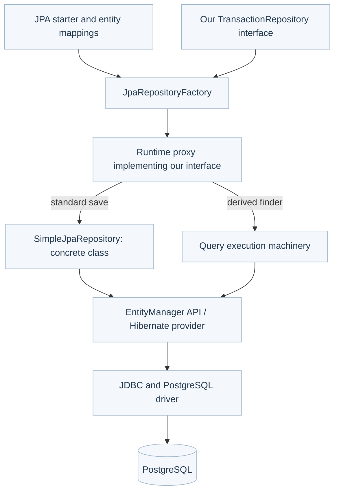

An interface declares operations; a concrete class supplies method bodies. Spring Data creates a proxy and chooses a store-specific base implementation during repository creation. Our setup is JPA, so its standard save delegates to SimpleJpaRepository. This is not a runtime competition among every interface shown by IntelliJ. A finder such as findByMerchantIdAndRequestKey uses query machinery, not a same-named method on SimpleJpaRepository.

Evidence: the locally inspected JpaRepositoryFactory source returns SimpleJpaRepository.class from getRepositoryBaseClass. No custom repository factory/base-class setting was found in the inspected practice source. This is source/configuration verification, not a claim that a debugger session inspected the live target.

First question: which item is our contract, and which class performs the standard save?

<a id="02-interface-hierarchy"></a>

## Interfaces versus concrete classes

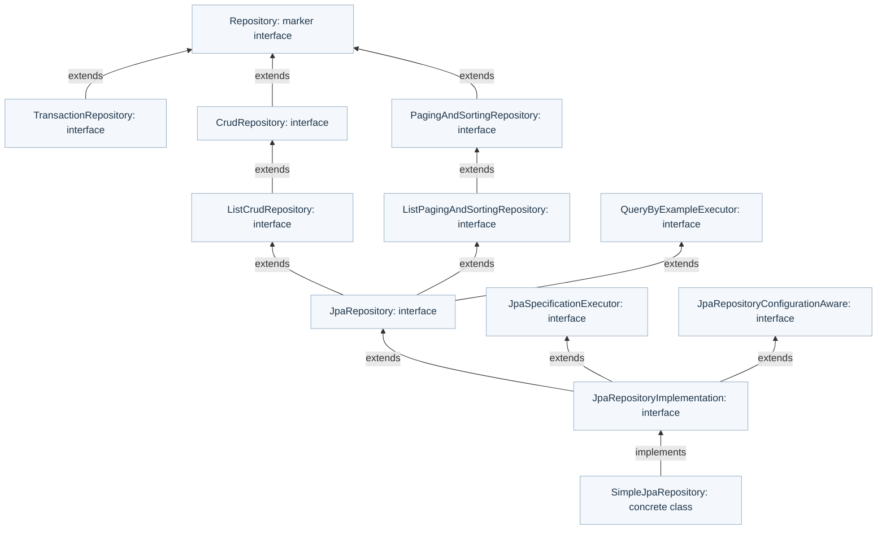

These arrows show Java type relationships, not the execution order. Our interface directly extends Repository, which has no operations. We expose only the methods we declare. JpaRepository is a broader alternative; we do not need to change our interface to understand the library.

PagingAndSortingRepository does not extend CrudRepository in this version. JpaSpecificationExecutor is not inherited by your interface just because the backing implementation supports it. Expose the required capability deliberately.

The exact declared public methods, including overloads, are in api-method-inventory.txt. Compiler-generated bridge methods appear in that raw inspection; they are not extra business operations.

<a id="03-crud-methods"></a>

## Default CRUD operations: what each family gives you

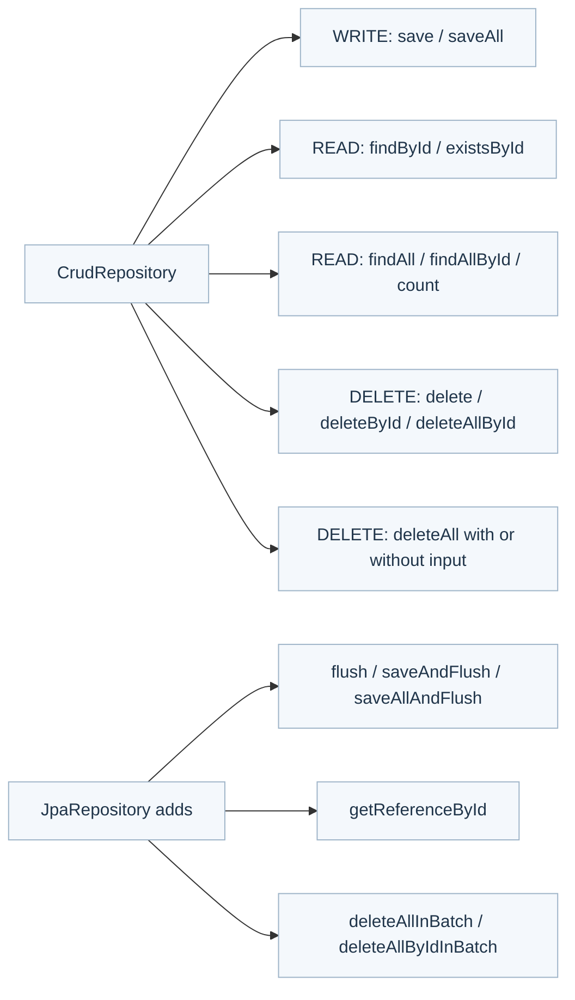

CRUD means Create, Read, Update, Delete. These are available when your interface extends the corresponding contract. Our narrow Repository does not inherit all of them.

| Method family | Use when | Review concern |
|---|---|---|
| save | Persist an entity's state | Does not mean INSERT only or SQL UPSERT; use its returned entity |
| saveAll | Save several entities | Does not guarantee one SQL statement or JDBC batching |
| findById | Read by primary key | Not merchant authorization; scope access separately |
| existsById | Check existence | Existence can change before a later operation |
| findAll / findAllById | Read a known bounded collection | Unbounded findAll can exhaust memory |
| count | Count rows | Can be expensive on large/filter-heavy workloads |
| delete / deleteById / deleteAllById | Remove selected entities | Deleting financial history needs an explicit retention rule |
| deleteAll | Remove many/all entities | Not appropriate as a casual payment-service operation |
| flush / saveAndFlush | Send queued SQL now | Flush is not COMMIT and can reduce batching opportunities |
| getReferenceById | Obtain an entity reference, often for relationships | It is not an existence check; failure may be delayed |
| batch deletion methods | Explicit bulk deletion | Can bypass entity callbacks/cascades and leave managed state stale |

Older getOne/getById and deleteInBatch signatures appear in the API inventory; they are deprecated aliases, not the preferred learning path.

<a id="04-list-results"></a>

## Why use ListCrudRepository?

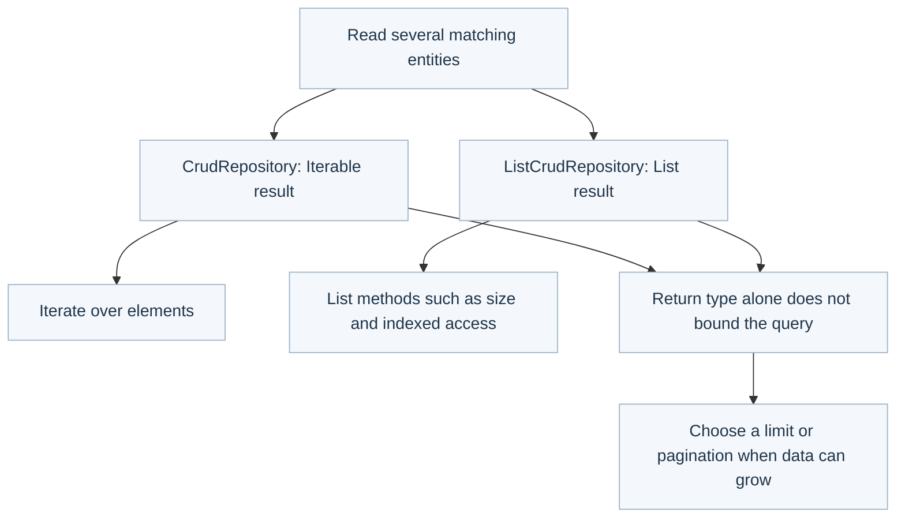

ListCrudRepository narrows collection return types: findAll, findAllById and saveAll return List instead of Iterable. It makes the API convenient for callers already needing a list. It does not promise a faster database query, sorted results, streaming or pagination. Iterable does not guarantee lazy loading either. SQL ordering must be requested explicitly.

<a id="05-query-options"></a>

## Choose how to express a query

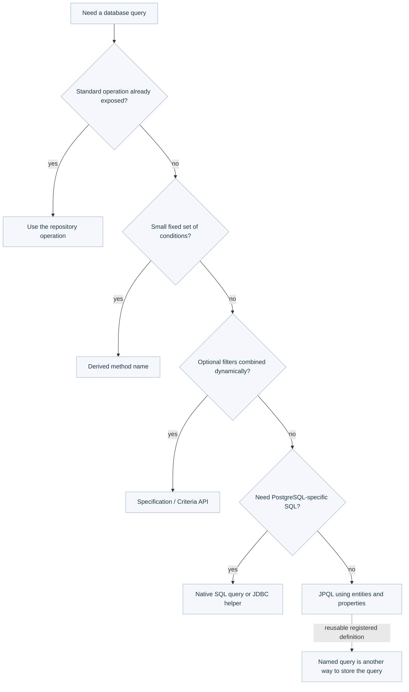

Derived names, JPQL, native SQL and criteria are alternatives for expressing a query. Named query describes where/how a reusable query is registered, not a separate database language. No choice is automatically faster: inspect SQL, data volume, indexes and the execution plan.

Common derived-name building blocks: findBy, existsBy, countBy, And, Or, Between, LessThan, GreaterThan, In, IsNull, OrderBy, First and Top. You still declare the method and its result type. Java property names must exist. Our property is requestKey, not requestId.

Default query lookup looks for a declared query first and derives from the name if none is found. A custom query takes responsibility for explicitly including merchant scope.

<a id="06-jpql-native-named"></a>

## JPQL, SQL and named queries

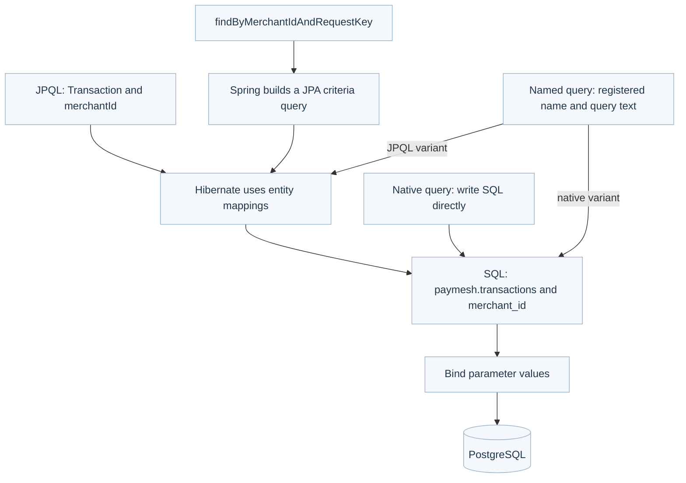

JPQL means Java Persistence Query Language. It queries entity types and Java properties. SQL uses tables and database columns. Hibernate translates JPQL using mappings such as @Table and @Column.

Explanatory fragments only; these are not new methods in the application:

```sql
-- JPQL text: entity name and Java field
select t from Transaction t
where t.merchantId = :merchantId and t.requestKey = :requestKey

-- Native PostgreSQL SQL: schema, table and columns
select t.* from paymesh.transactions t
where t.merchant_id = :merchantId and t.request_key = :requestKey
```

The colon parameters above are bound by the framework; they are not PostgreSQL console variables by themselves.

| Annotation | Meaning |
|---|---|
| org.springframework.data.jpa.repository.Query | Place JPQL on a repository method |
| @Query(nativeQuery = true) | Place SQL on a repository method |
| jakarta.persistence.NamedQuery | Register a named JPQL query on an entity or via metadata |
| jakarta.persistence.NamedNativeQuery | Register a named SQL query |
| org.springframework.data.repository.query.Param | Associate a method parameter with a named query parameter |
| @Modifying | Mark an annotated update/delete query as a modifying operation; it does not itself create a transaction |

For convention-based lookup, a query named Transaction.findForRequest can back a declared repository method named findForRequest. You must supply the matching query definition and parameters. Native queries can require explicit result mapping and pagination count queries; custom SQL does not automatically preserve entity lifecycle behavior.

<a id="07-save-internals"></a>

## What standard save actually decides

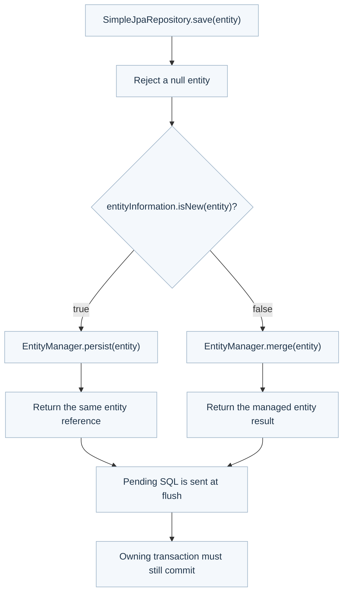

Newness is metadata-based; it does not always mean querying PostgreSQL to see whether the row exists. With default detection, a nullable version property is considered first; otherwise a null identifier signals newness. Persistable can customize this.

Our constructor assigns a UUID and our entity has no version property. Default detection therefore chooses merge. Merge can still INSERT when no matching row exists; it is not necessarily UPDATE. It can return a different managed instance, which is why our service returns repository.save(transaction).

The generic S is a type parameter bounded by the entity type, not a database transaction. @Override indicates implementation/overriding of a declared Java method; it does not enable transaction behavior.

<a id="08-entity-manager"></a>

## What the EntityManager does

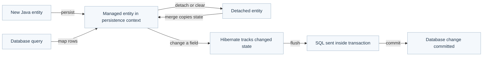

The EntityManager is the JPA interface for entity lifecycle, lookup and queries. Hibernate supplies the implementation. A persistence context tracks managed entity instances. It is not a globally shared cache for all users.

| Method | Purpose |
|---|---|
| persist | Make a new entity managed |
| merge | Copy entity state into a managed instance and return that instance |
| find | Find a managed entity by type and identifier, using context/database as needed |
| getReference | Obtain a reference without promising immediate existence verification |
| createQuery / createNativeQuery | Execute JPQL/criteria or SQL |
| flush | Synchronize pending changes with the database |
| detach / clear | Stop tracking one/all managed entities; not a database rollback |
| refresh | Reload an entity's state; can discard local changes |
| remove | Mark a managed entity for deletion |

Do not share a raw EntityManager or mutable managed entity concurrently across threads. Do not close a Spring-injected managed EntityManager yourself. AutoCloseable is Java's resource-cleanup contract used by try-with-resources; JDBC connections/statements/results acquired directly need deliberate ownership and closure. Closing a connection is not the same concept as committing a transaction.

<a id="09-pagination"></a>

## Lists, pages, slices and scrolling

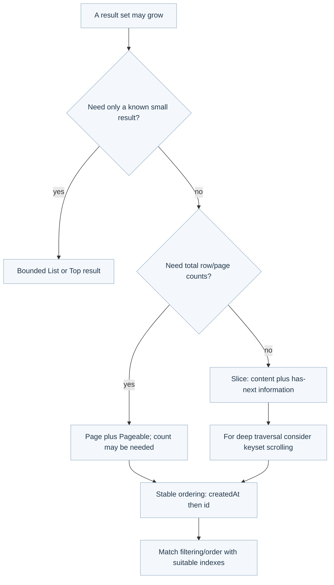

Pageable describes page size, offset and sort. PageRequest is a common implementation. Sort describes ordering but does not limit row count. Page includes totals and may need a count query. Slice avoids requiring a total and commonly fetches an extra row to detect more data.

For merchant-facing listings, use a merchant-scoped query rather than unscoped inherited findAll(Pageable). Stable ordering needs a tie-breaker such as id. Offset pagination can skip increasing numbers of rows and is sensitive to concurrent changes. Keyset scrolling continues from the last ordered values; it requires a compatible query, sort and index. It is not an automatic feature of every arbitrary query.

Hypothetical example: request 20 records, sorted by createdAt and id; never equate using a List with limiting the query to 20.

<a id="10-annotation-map"></a>

## Annotations by responsibility

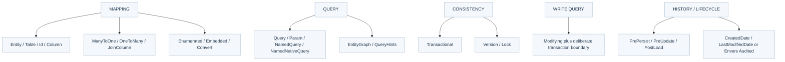

These are a focused catalogue, not every annotation in the ecosystem. Imports determine which framework an annotation belongs to.

| Annotation | Where / when | Important limit |
|---|---|---|
| @Entity, @Table | Entity class and its table | Does not itself create the table with ddl-auto=none |
| @Id, @GeneratedValue | Identifier mapping/generation | Our entity assigns UUID itself; no GeneratedValue currently |
| @Column | Column mapping | nullable=false is not comprehensive request validation |
| @Enumerated(EnumType.STRING) | Enum value stored by name | Renaming enum values needs a data migration |
| @Embedded, @Embeddable | Group value fields | Not a separate table automatically |
| @ManyToOne, @OneToMany, @JoinColumn | Model actual relationships | Fetching and cascade rules need explicit review |
| @Convert | Convert an attribute representation | Not a universal replacement for database types |
| @Version | Optimistic concurrency check for updates | Requires a version column; not currently in our table |
| @Lock | Request a JPA lock mode on a query | Not a Java synchronized lock; needs suitable transaction scope |
| @EntityGraph | Specify related entities to fetch | More fetching is not always faster |
| @QueryHints | Provider/query execution hints | Provider-specific effects require verification |
| @Transactional | Transaction boundary/settings | Proxy calls and rollback rules matter; not Java thread safety |
| @Modifying | Annotated update/delete operation | Bulk changes can leave the persistence context stale |
| @PrePersist, @PreUpdate, @PostLoad | Entity lifecycle callbacks | Avoid external calls and hidden business workflows |
| @CreatedDate, @LastModifiedDate | Spring Data auditing metadata | Requires auditing setup; not full revision history |
| @Audited | Envers revision history | Requires Envers dependency and configuration; not enabled |
| @Repository | Spring component stereotype/exception translation support | Different from the Repository interface |
| @NoRepositoryBean | Intermediate generic repository interface | Prevents creating a repository for an unresolved generic type |

Mappings and lifecycle annotations above are generally jakarta.persistence; Query, Modifying, EntityGraph, QueryHints and Lock here are Spring Data JPA. Transactional here is Spring's transaction annotation. Audited is from Hibernate Envers.

<a id="11-transactions-concurrency"></a>

## Atomicity is not mutual exclusion

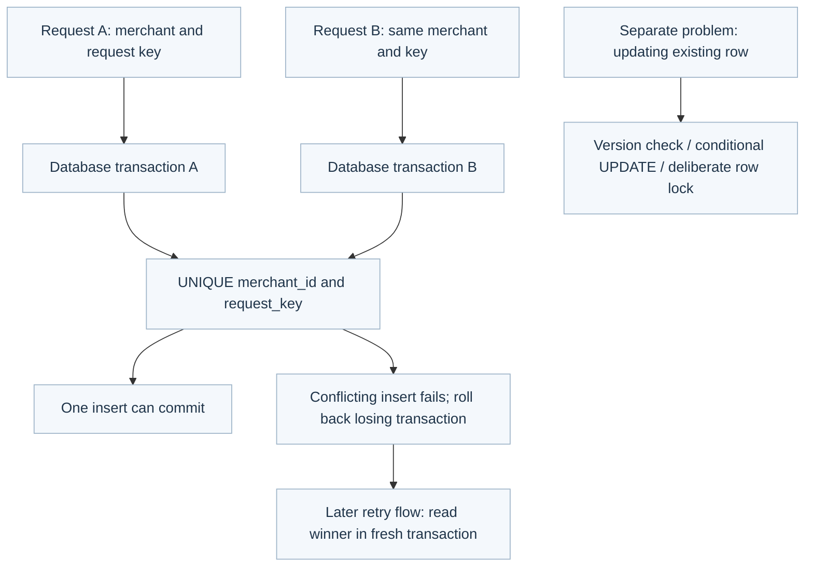

Two transactions can run concurrently. @Transactional does not make an exists-then-insert sequence race-free. The unique constraint arbitrates duplicate creation across application instances. Our retry-return-original behavior is not implemented yet.

REQUIRED joins an existing transaction by default. REQUIRES_NEW starts an independent one and may need another connection; it can commit even if its caller later rolls back. NESTED uses savepoint semantics only when the transaction manager and underlying access support them; do not assume JPA entity state supports nested rollback. A savepoint is not an independent committed transaction.

Database rollback rules do not undo Java object changes, sent messages or external provider effects. Checked exception rollback must be configured deliberately. For a full discussion of the all-or-nothing boundary, see the existing commit-and-rollback diagram.

<a id="12-choose-access-stack"></a>

## Which implementation family belongs to which stack?

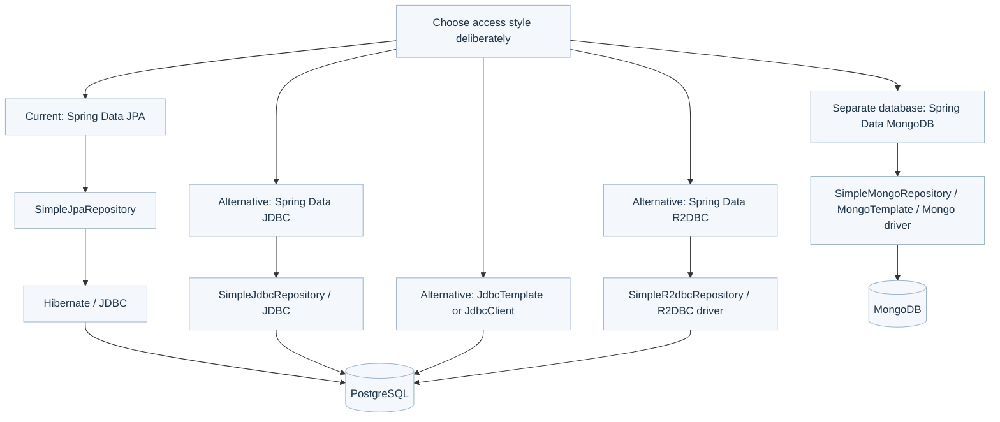

Only the JPA route is the current repository setup. JdbcTemplate is available for SQL exercises, but Spring Data JDBC, R2DBC, MongoDB and Envers are not implemented by this application. Other diagrams show comparisons, not activated features.

| Contract or tool | When to consider it | Trade-off |
|---|---|---|
| Narrow Repository | Expose only required operations, as we do | Declare each needed method |
| CrudRepository | Standard entity operations are sufficient | Broad operations still need access controls |
| ListCrudRepository | Callers want List results | Does not bound or speed up SQL |
| JpaRepository | Need JPA-specific operations plus CRUD/paging | Understand persistence context and flushing |
| JpaSpecificationExecutor | Many optional/composable filters | More machinery than a small fixed query |
| QueryByExampleExecutor | Simple matching from an example object | Limited expressive power for complex joins/conditions |
| JdbcTemplate / JdbcClient | Explicit SQL and predictable result mapping | You write SQL and mapping deliberately |
| ReactiveCrudRepository / ReactiveSortingRepository | End-to-end non-blocking stack with a supported reactive driver | Not a drop-in replacement for blocking JPA |
| RxJava3CrudRepository / RxJava3SortingRepository | A compatible reactive store with an RxJava API preference | Store support, adapters and dependencies must be verified |
| RevisionRepository | Query historical entity revisions with a supported auditing module | Not automatically enabled; not a financial ledger |

The Reactor interfaces use Mono (zero/one result) and Flux (multiple results). RxJava uses Single (one), Maybe (zero/one), Flowable (multiple) and Completable (completion only). Merely changing a return type does not convert JDBC/Hibernate into non-blocking database work. R2DBC uses its own ConnectionFactory and driver, not the JDBC DataSource.

RevisionRepository adds findLastChangeRevision, findRevisions and findRevision. Envers supplies the audit integration when configured. A repository can combine CRUD and revision contracts; this does not mean every method now runs through a different save implementation.

## Verification and remaining gaps

- Interface inheritance and declared signatures were inspected from local Spring Data JPA/Commons 3.5.9 binaries. Save dispatch and persist/merge branching were inspected from matching source JARs.
- These diagrams describe configuration/source behavior, not a newly observed live runtime proxy instance. No database writes, cloud calls, application changes or dependency installations were performed.
- Other concrete implementation names are documented alternatives; their modules are not enabled here. No MongoDB or reactive integration was tested.
- The method inventory includes all declared public signatures for the selected families, not every method in every library. Inherited methods are available through the inheritance relationships; bridge methods may duplicate signatures in bytecode output.
- Mermaid text and internal links were checked. No standalone raster export or external diagram renderer was used; open the Markdown in a Mermaid-capable preview.
- SaveAndFlush, batch deletes, reference lookup and reactive APIs need separate hands-on tests before claiming proficiency. Reading a diagram does not demonstrate understanding.

## Official sources

- [Core repository interfaces](https://docs.spring.io/spring-data/jpa/reference/3.5/repositories/core-concepts.html)
- [Selective methods and implementation selection](https://docs.spring.io/spring-data/jpa/reference/3.5/repositories/definition.html)
- [Query creation and declared queries](https://docs.spring.io/spring-data/jpa/reference/3.5/jpa/query-methods.html)
- [Query lookup, pagination and scrolling](https://docs.spring.io/spring-data/jpa/reference/3.5/repositories/query-methods-details.html)
- [Entity save/new detection](https://docs.spring.io/spring-data/jpa/reference/3.5/jpa/entity-persistence.html)
- [Specifications](https://docs.spring.io/spring-data/jpa/reference/3.5/jpa/specifications.html)
- [Locking](https://docs.spring.io/spring-data/jpa/reference/3.5/jpa/locking.html)
- [Envers setup](https://docs.spring.io/spring-data/jpa/reference/3.5/envers/configuration.html)
- [Spring Data JDBC query methods](https://docs.spring.io/spring-data/relational/reference/3.5/jdbc/query-methods.html)
- [R2DBC repositories](https://docs.spring.io/spring-data/relational/reference/3.5/r2dbc/repositories.html)
- [Mongo repository implementation](https://docs.spring.io/spring-data/data-mongodb/docs/current/api/org/springframework/data/mongodb/repository/support/SimpleMongoRepository.html)

Spring 3.5-line documentation may show a newer patch; no project dependency was upgraded. The Mongo API source is a current reference for a comparison, not our installed stack.
