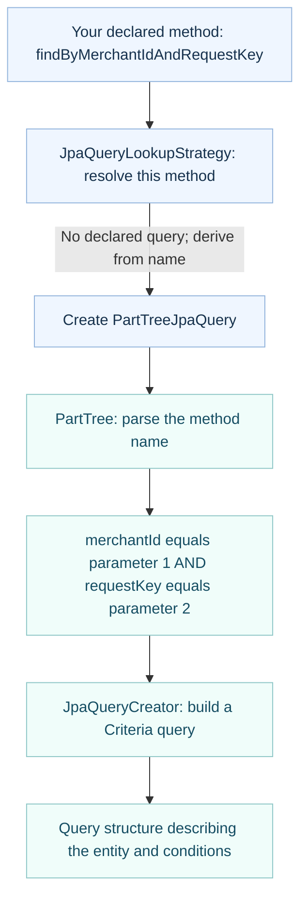
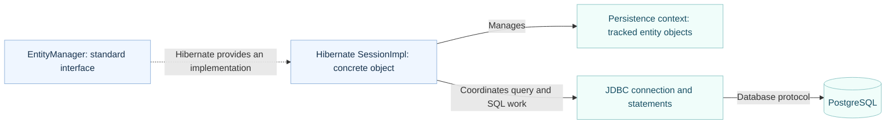

# From a derived finder to PostgreSQL

Read one numbered section at a time. These are conceptual call flows, not timing measurements or interface-inheritance diagrams.

Scope: the current `TransactionRepository`, Spring Data JPA 3.5.9, Hibernate 6.6.42.Final. Framework source was inspected on 31 October 2026; this is not a captured debugger trace. Application code and configuration were not changed.

## 1. Preparing the finder

A **derived finder** is a repository method whose search conditions Spring derives from its name. Our example is `findByMerchantIdAndRequestKey`. Spring does not write a matching handwritten method inside `SimpleJpaRepository`.



This preparation normally happens when the repository is initialized. Some query structures can be cached; dynamic arguments can require rebuilding them. Parsing the method name is not a new source-code generation step on every call. Java property names are used here; entity mappings supply database column names later.

**Criteria API** means an application programming interface for constructing a query using Java objects rather than writing query text. A **predicate** means a condition that must be true.

## 2. Executing a call with real values

Synthetic example: merchant `merchant-A`, request key `request-42`. The diagram expands only the finder path. Transaction and exception-handling interceptors also exist and are omitted for readability. An interceptor is code that receives a method call before the underlying work runs.

```mermaid
sequenceDiagram
    participant caller as Your service
    participant proxy as Repository proxy
    participant interceptor as QueryExecutorMethodInterceptor
    participant derived as PartTreeJpaQuery + execution helpers
    participant em as Spring EntityManager proxy
    participant provider as Hibernate Session / Query
    participant driver as PostgreSQL JDBC driver
    participant db as PostgreSQL
    caller->>proxy: findByMerchantIdAndRequestKey(merchant-A, request-42)
    proxy->>interceptor: Intercept finder call
    interceptor->>derived: Execute registered query with arguments
    Note over interceptor,derived: RepositoryMethodInvoker connects the method to its query
    derived->>em: createQuery(criteriaQuery)
    em->>provider: Delegate to the current EntityManager
    provider-->>derived: TypedQuery implemented by Hibernate
    derived->>provider: ParameterBinder binds merchant-A and request-42
    Note over derived,provider: Binding supplies values; it does not execute the SELECT
    derived->>provider: SingleEntityExecution calls getSingleResult()
    provider->>driver: Prepare and execute parameterized SQL
    driver->>db: SELECT matching transaction
    db-->>driver: Matching row, or no rows
    driver-->>provider: Result data
    provider-->>derived: Map row to Transaction, or report no result
    derived-->>interceptor: Result; no-result case is adapted
    interceptor-->>proxy: Adapt to Optional return type
    proxy-->>caller: Optional of Transaction, or Optional.empty()
```

The query is created through `EntityManager`; execution happens through the returned query object's result method. `ParameterBinder` assigns arguments to query parameters. Hibernate translates the query into SQL (Structured Query Language), uses JDBC (Java Database Connectivity) to communicate with PostgreSQL, and maps returned columns to an entity. The JDBC connection may be borrowed from the application's connection pool; the pool does not parse finder names.

Conceptual SQL, not a captured log (actual aliases and selected-column ordering vary):

```sql
SELECT id, merchant_id, request_key, amount_minor, currency, status, created_at
FROM paymesh.transactions
WHERE merchant_id = ? AND request_key = ?;
```

Our unique database constraint on `(merchant_id, request_key)` prevents multiple matching rows. In general, an `Optional` return type does not limit a query to one row: multiple matches can cause an incorrect-result-size exception. Finding no row is not a safe reservation for a later insert; the uniqueness constraint still matters for concurrent requests.

## 3. What each box actually is

| Name | Kind | Responsibility |
|---|---|---|
| `TransactionRepository` | Our interface | Declares operations and return types. |
| Repository proxy | Spring-created object implementing our interface | Receives calls and applies the relevant interceptors. |
| `QueryExecutorMethodInterceptor` | Spring Data concrete class | Dispatches a finder to its registered query and adapts the result. |
| `PartTreeJpaQuery` | Spring Data JPA concrete class | Holds and prepares the name-derived query; uses execution helpers. |
| `PartTree` | Spring Data concrete parser class | Interprets property names, operators, `And`, `Or`, limits and sorting. |
| `JpaQueryCreator` | Spring Data JPA concrete class | Builds Criteria query conditions from the parsed tree. |
| `ParameterBinder` | Spring Data JPA concrete class | Binds call arguments to query parameters. |
| `JpaQueryExecution.SingleEntityExecution` | Spring Data JPA nested concrete class | Retrieves a single result for this finder. Other result shapes use other strategies. |
| `EntityManager` | Jakarta Persistence interface | Offers operations for managing entity instances and creating queries. |
| Spring EntityManager proxy | Spring-created delegating object | Resolves the EntityManager associated with the current transaction in this setup. |
| `Session` | Hibernate interface extending `EntityManager` | Hibernate's persistence-context API. |
| `SessionImpl` | Hibernate concrete implementation | Manages entity state and coordinates Hibernate query operations. |
| Hibernate | A library, not one class | Implements Jakarta Persistence and object-relational mapping. |
| PostgreSQL JDBC driver | A library with concrete connection/statement classes | Sends database operations and reads results using PostgreSQL's protocol. |
| PostgreSQL | Database server | Executes SQL, enforces constraints and manages stored data and transactions. |

## 4. EntityManager versus Hibernate

An **entity** is an object mapped to stored data, such as our `Transaction`. A **persistence context** is the set of entity objects managed together by an EntityManager. It tracks their identities and changes. It is not the database itself or a database connection.



The dotted edge is an implementation relationship, not an extra network call. Hibernate is running inside the Java application; PostgreSQL is the database server.

For this lesson: EntityManager is the standard contract; Hibernate supplies the working implementation. Its managed context is not thread-safe. Do not share the underlying Session or mutable managed entities across worker threads. Spring's shared proxy can route different threads to different transaction-bound EntityManagers; that does not make the underlying Session thread-safe.

Query execution is not automatically a commit. Transaction completion belongs to the surrounding transaction boundary. A query can also cause pending changes to flush under applicable flush rules; flushing still is not committing.

## 5. Inspect in IntelliJ, one stop at a time

1. `QueryExecutorMethodInterceptor.doInvoke`: select the query registered for the method.
2. `PartTreeJpaQuery`: locate `new PartTree(method.getName(), domainClass)`.
3. `PartTree`: inspect `And` / `Or` parsing.
4. `JpaQueryCreator.and`: combine predicates with the Criteria builder.
5. `PartTreeJpaQuery.QueryPreparer`: create the query through EntityManager and bind parameters.
6. `JpaQueryExecution.SingleEntityExecution.doExecute`: inspect `getSingleResult()`.

These are suggested source-reading locations, not claims that debugger breakpoints have been exercised. Opening framework source is sufficient for this discussion; no code changes are required.

Closed-book question: which component interprets the method name, and which component actually executes SQL?

## Sources and verification

- Locally inspected Spring Data Commons / JPA 3.5.9 source archives: `QueryExecutorMethodInterceptor`, `PartTree`, `JpaQueryLookupStrategy`, `PartTreeJpaQuery`, `JpaQueryCreator`, `AbstractJpaQuery`, `JpaQueryExecution`.
- Locally inspected Hibernate 6.6.42.Final source: `Session` and `SessionImpl`.
- [Spring Data query derivation, 3.5 documentation](https://docs.spring.io/spring-data/jpa/reference/3.5/repositories/query-methods-details.html).
- [Jakarta EntityManager interface reference](https://jakarta.ee/specifications/platform/9/apidocs/jakarta/persistence/EntityManager.html). This older platform reference is used only for the stable interface responsibilities explained above.
- [Hibernate 6.6 Session reference, including thread-safety restrictions](https://docs.hibernate.org/orm/6.6/javadocs/org/hibernate/Session.html).
- [Back to the repository atlas](README.md).

Verification: class roles and selected calls checked against cached framework source. Diagrams are teaching abstractions; generated SQL, latency and a live call stack have not been measured here. Snippets are explanatory and were not executed.
