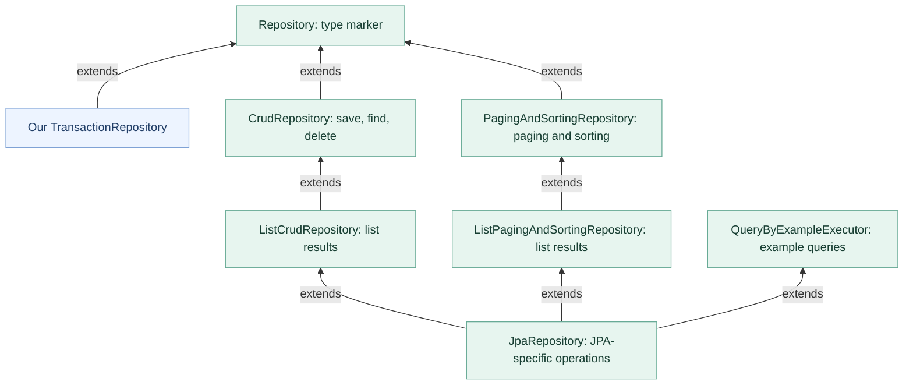
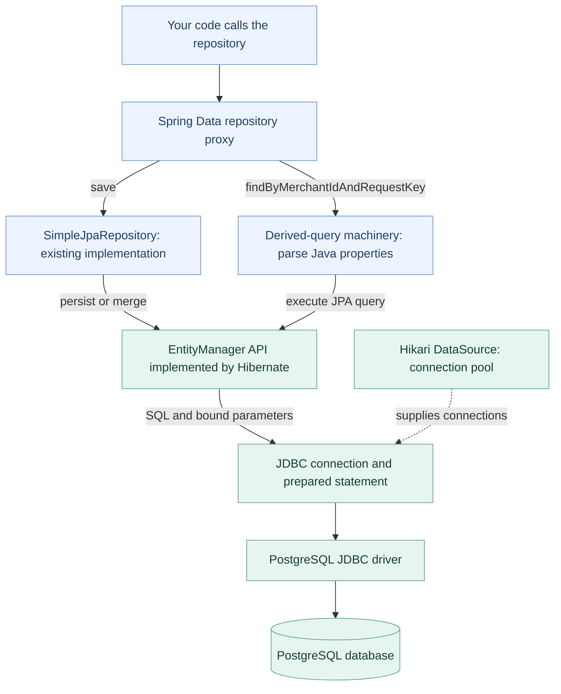
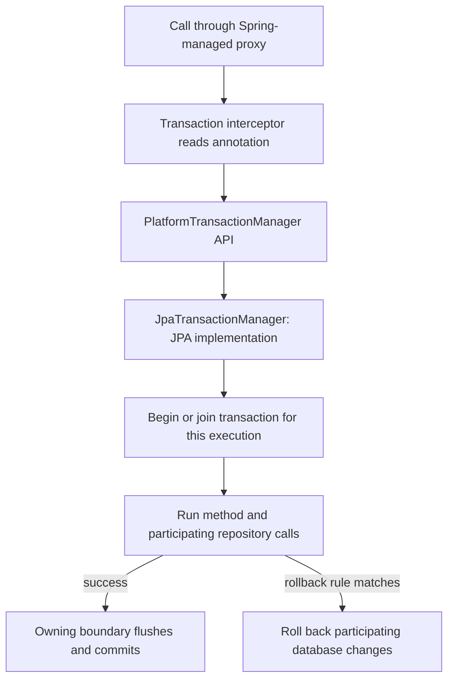
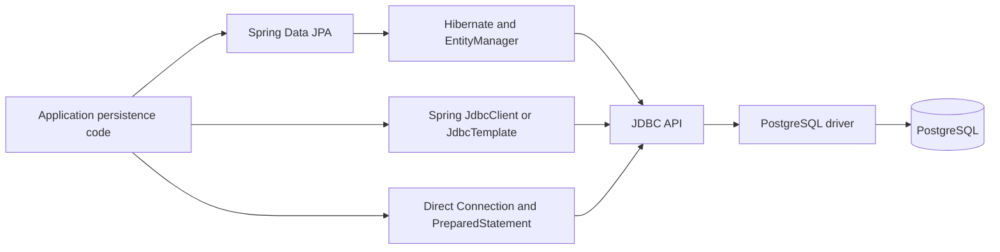

# Spring database learning map

This is a map of the core interfaces, implementations and runtime paths relevant to our practice project, not a catalogue of every Spring class. Read one diagram at a time. No Java implementation was changed to create this guide.

Verified on 31 October 2026 against the repository source and interface declarations in the locally cached Spring Data JPA and Commons 3.5.9 libraries. Official references below use the corresponding 3.5 documentation line. Service and test implementations were cleared for the learner to rewrite; their re-creation is learner work, not an already completed feature.

## 1. Our repository contract

A repository is the application's database-access boundary. Our TransactionRepository is an interface: it declares operations without their method bodies. Spring Data creates an object implementing it at runtime.

```java
public interface TransactionRepository
        extends Repository<Transaction, UUID> {
    <S extends Transaction> S save(S transaction);
    Optional<Transaction> findByMerchantIdAndRequestKey(
            String merchantId, String requestKey);
    Optional<Transaction> findByIdAndMerchantId(UUID id, String merchantId);
}
```

This excerpt omits the transaction annotations to focus on the type contract. Repository<T, ID> is a marker interface. It identifies the entity type and identifier type; it does not itself declare save. We selectively declare save with the standard CRUD signature. Spring Data routes that operation to SimpleJpaRepository. The finder methods are derived from their names, not implemented as matching named methods on SimpleJpaRepository.

S is a generic type parameter, not a separate class. It means Transaction or a subtype here. It preserves the input/output type relationship; it does not promise that the returned reference is the same object.

## 2. Interface inheritance — arrows mean extends only



CRUD means Create, Read, Update, Delete. Our interface does not extend JpaRepository and does not expose its entire API. The narrow contract avoids accidentally offering operations such as deleting all records. It is not an authorization boundary.

In this Spring Data version, PagingAndSortingRepository does not extend CrudRepository. Older diagrams sometimes show that outdated relationship. JpaRepository inherits both families through the List variants, as well as QueryByExampleExecutor. SimpleJpaRepository implements JpaRepositoryImplementation, which itself extends JpaRepository and JpaSpecificationExecutor; these internal/advanced types are intentionally not shown in the core diagram.

## 3. Runtime access — arrows mean calls or delegation, not inheritance



API means Application Programming Interface: operations a component exposes. JPA means Jakarta Persistence, an API/specification for mapping objects and managing persistence. Hibernate is the JPA provider used here; JPA is not a database server. JDBC means Java Database Connectivity: Java's lower-level relational-database API. PostgreSQL is the database server; its JDBC driver is a Java library that communicates with it.

The diagram compresses some framework layers. Hibernate uses the JDBC APIs; the PostgreSQL driver supplies implementations of those interfaces. A prepared statement binds values separately from SQL text. SELECT results travel back through ResultSet and Hibernate's mapping to Java entities. A finder returning Optional represents zero or one entity, not an arbitrary result list.

save need not send an INSERT immediately. Hibernate may flush later, including at commit. Our constructor assigns a non-null UUID and the entity has no version field, so default new-entity detection chooses merge. This may require a SELECT before an INSERT. Use the entity returned by save; save is not an SQL UPSERT or complete retry/idempotency handling.

## 4. Transaction control — separate from query execution



Default propagation joins an existing transaction. A repository save therefore normally joins a transactional service method when called through the managed objects. Commit is at the owning boundary, not after every nested method. Default rollback rules cover RuntimeException and Error, not all checked exceptions. Transactional database atomicity does not serialize Java threads, roll back external calls, or remove the need for constraints.

JpaTransactionManager manages the JPA persistence context and database transaction. JdbcTransactionManager/DataSourceTransactionManager are alternatives for ordinary JDBC-based transaction management; do not draw them as children or additional steps of JpaTransactionManager. TransactionTemplate offers explicit transaction demarcation using a transaction manager. A pooled connection may be reused later, after the previous transaction has completed; connection identity and transaction identity are different.

## 5. Other database access paths — alternatives, not one inheritance chain



- Spring Data JPA: entity mapping, persistence context and repository abstraction; SQL behavior still needs review.
- JdbcTemplate / NamedParameterJdbcTemplate: write SQL explicitly; Spring handles common JDBC resource/error handling. NamedParameterJdbcTemplate supports named parameters.
- JdbcClient: a fluent facade for JDBC query/update work. It is an alternative API available in the Spring JDBC line, not something the current repository calls.
- Direct JDBC: explicit Connection, PreparedStatement, ResultSet and resource management; more control and more boilerplate.
- Spring Data JDBC is a separate persistence module with aggregate-oriented mapping. It is not the same thing as JdbcTemplate and is not implemented by this application.
- R2DBC is a separate reactive database API/driver path; it does not simply wrap our blocking JPA call. MongoDB, Redis and DynamoDB use other libraries and data models. These are later comparisons, not dependencies required for this exercise.

## 6. Vocabulary to learn gradually

| Family | Main types | Responsibility |
|---|---|---|
| Spring Data contract | Repository, CrudRepository, ListCrudRepository | Entity operations and generic type contracts |
| Pagination | Pageable, PageRequest, Page, Slice, Sort | Bounded retrieval and ordering; Page often needs a count query |
| JPA repository extensions | JpaRepository, JpaSpecificationExecutor, Specification, Example | JPA operations and optional query composition |
| Repository creation | JpaRepositoryFactoryBean, JpaRepositoryFactory | Build runtime repository implementations/proxies |
| Repository implementation | SimpleJpaRepository | Common JPA-backed CRUD operations |
| JPA persistence | EntityManagerFactory, EntityManager | Create persistence contexts and manage entity/query work |
| JPA queries | Query, TypedQuery, CriteriaBuilder, CriteriaQuery | Represent and execute queries |
| Hibernate provider | SessionFactory, Session | Hibernate's provider-level APIs; not necessary for basic repository use |
| Connection source | javax.sql.DataSource, HikariDataSource | Acquire and pool connections; DataSource stays in javax.sql |
| JDBC | Connection, PreparedStatement, ResultSet, SQLException | Database session, parameterized SQL, returned rows, failures |
| Spring JDBC | JdbcTemplate, NamedParameterJdbcTemplate, JdbcClient, RowMapper | SQL access helpers and explicit row-to-object mapping |
| Transactions | PlatformTransactionManager, JpaTransactionManager, TransactionTemplate | Begin/join/commit/rollback coordination |
| Error translation | DataAccessException, DataIntegrityViolationException | Spring's common persistence exception hierarchy |
| Schema changes | Flyway | Apply versioned schema changes when explicitly enabled |

Entity annotations describe mapping: @Entity, @Table, @Id, @Column, and later @Version and relationship annotations. @Transactional describes transaction rules. @Repository is a Spring stereotype annotation; Repository is a Spring Data interface. They are different constructs. Our interface is discovered through Spring Data repository scanning; no explicit @Repository annotation is required on it.

An EntityManager/persistence context must not be shared concurrently across worker threads. Spring's injected proxy routes work to the context bound to the current operation; do not manually cache a raw context or mutable entity in a singleton service. New worker threads do not automatically inherit an imperative transaction.

Flyway is available as a dependency but disabled in our profile. H2 is an alternative embedded database for the default profile; it is not an extra layer between Hibernate and PostgreSQL. Adding a dependency does not mean the feature is implemented or enabled.

## Learn one box at a time

1. Our TransactionRepository: an interface, not the database.
2. Repository<T, ID>: a type marker; why we declare save selectively.
3. Runtime repository proxy and SimpleJpaRepository.
4. EntityManager API versus Hibernate provider.
5. JDBC, driver, connection pool and PostgreSQL.
6. Transaction boundaries and failure behavior.
7. Query alternatives and pagination when the exercise needs them.

First recall question: does our TransactionRepository contain SQL execution code, or does it declare operations that Spring Data implements?

## Sources

- [Spring Data 3.5 core interfaces](https://docs.spring.io/spring-data/jpa/reference/3.5/repositories/core-concepts.html)
- [Selective repository methods and SimpleJpaRepository delegation](https://docs.spring.io/spring-data/jpa/reference/3.5/repositories/definition.html)
- [Saving entities and new-state detection](https://docs.spring.io/spring-data/jpa/reference/3.5/jpa/entity-persistence.html)
- Local interface declarations inspected from Spring Data JPA and Commons 3.5.9 JARs; no library versions changed.
