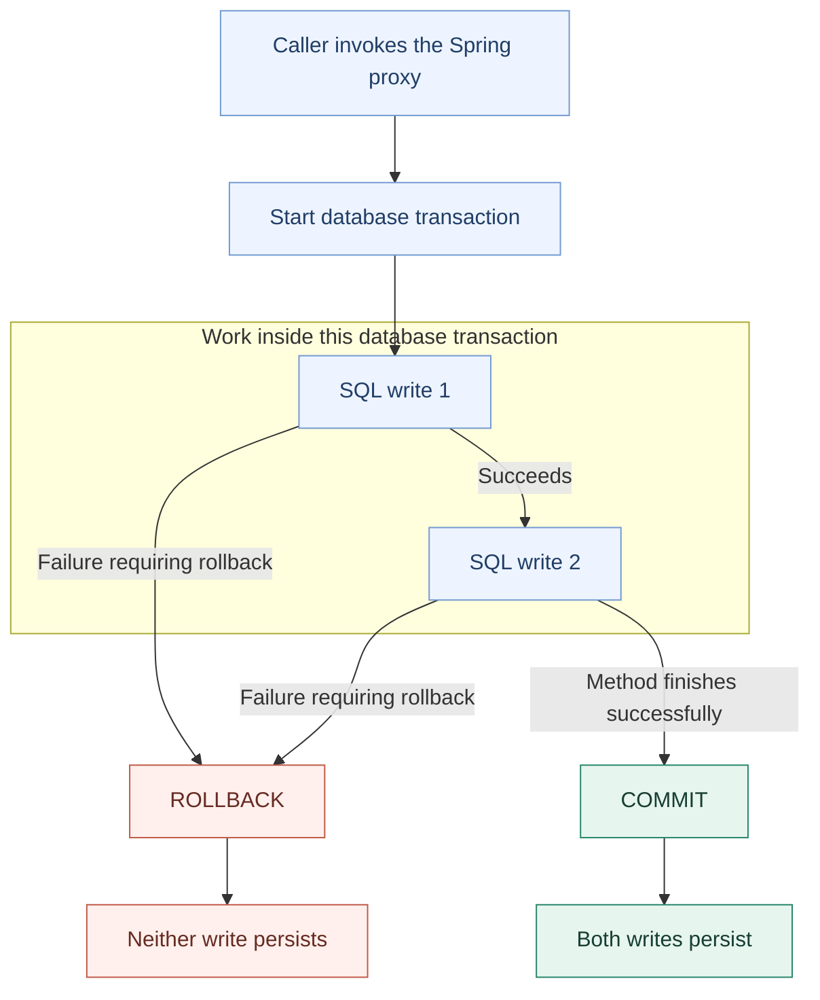

# Database transaction: commit and rollback

One database transaction: both writes commit, or neither persists.

This is a teaching example with two database writes. Our repository save operation concerns one transaction record; this diagram does not claim that an audit/outbox write has been implemented.

Both SQL writes belong to the same database transaction. The first write succeeding does not mean it has committed. Spring's proxy asks the configured transaction manager to start or join the transaction, invokes the method, and completes the transaction at the owning boundary. The database performs the commit or rollback.

| Included in rollback | Not automatically undone |
|---|---|
| Database changes in this transaction | Changes to Java objects |
| Earlier successful writes in this transaction | Printed logs or sent emails |
| | Calls to an external payment provider |
| | Work already committed in a different transaction |

- By default, an escaping RuntimeException triggers rollback; not every exception does. Error also triggers rollback by default; checked exceptions require an applicable rollback rule.
- If a transaction already exists, the method normally joins it. Commit happens at the outer boundary.
- Atomic does not mean only one thread runs. Other transactions can execute concurrently; constraints and isolation still matter.
- Flush sends pending SQL; it is not commit. The success path assumes commit succeeds; commit can itself fail.

Reference: [Spring transaction annotations](https://docs.spring.io/spring-framework/reference/data-access/transaction/declarative/annotations.html).
